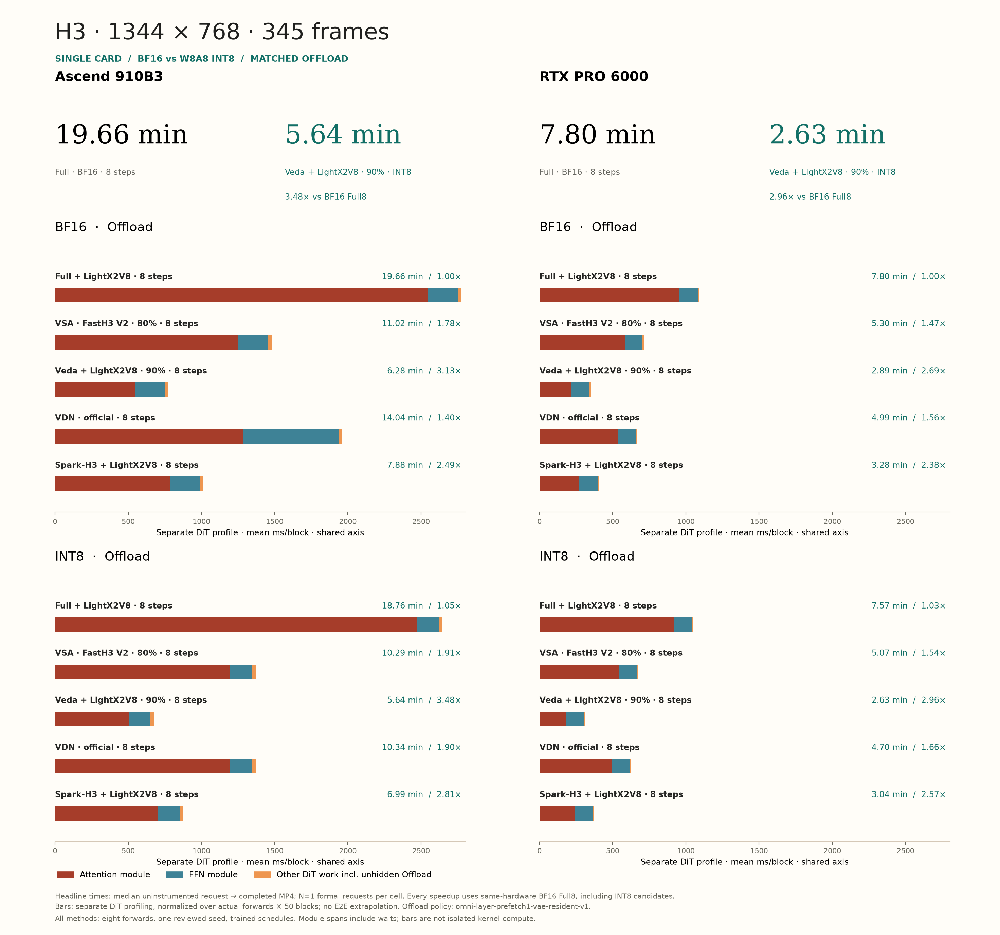

# Ascend-H3

[中文说明](README.zh-CN.md)

MiniMax H3 inference on Ascend with Full, VSA, Veda, VDN and Spark-H3
attention in one repository. The integration reuses vLLM-Omni model loading,
INT8 transformer quantization and native tensor parallel attention heads.

**Integration validation is in progress.** The source operators have compiled
successfully; this branch is not yet a qualified release of every
method × precision × workload × parallel configuration. The single-card end-to-end matrix is being remeasured against eight-step Full H3.

## Workloads

| Case | Width × height | Native output frames | Latent video grid |
| --- | --- | --- | --- |
| `672-124` | 672×384 | 124 | 37×12×21 |
| `672-345` | 672×384 | 345 | 102×12×21 |
| `1344-124` | 1344×768 | 124 | 37×24×42 |
| `1344-345` | 1344×768 | 345 | 102×24×42 |

Output FPS is 24. Requests use explicit frame counts, with frame interpolation
disabled. The long case is the agreed native 345-frame workload; it is not
cropped to 341 frames. BF16 and INT8 use the same four geometries.

## Installation

Use Linux, Python 3.12 and a compatible Ascend Torch/CANN environment.
Install the pinned vLLM, vLLM-Ascend and vLLM-Omni stack described in
[the environment notes](docs/environment.md). Do not combine unrelated
framework releases. Then install this repository from source:

```bash
git clone https://github.com/Huage001/Ascend-H3.git
cd Ascend-H3
source /path/to/Ascend/cann/set_env.sh
bash scripts/install_stack.sh /path/to/private/framework-sources
export H3_ASCEND_CACHE=/path/to/writable/ascend-h3-cache
h3-ascend build --method all --soc Ascend910B3
```

Builds contain no model weights and run without occupying an NPU. Native
libraries are compiled locally and kept outside the checkout. For a single
backend, replace `all` with `vsa`, `veda` or `spark`; Full and VDN do not
require these custom CANN extensions. Keep the editable checkout available.

## Checkpoints and algorithm choices

| Method | Required model assets | Computation |
| --- | --- | --- |
| `full` | H3 base; LightX2V 8-step by default, or a community LoRA | Dense attention |
| `vsa` | Complete official FastH3 V2 student, including all 50 trained compression gates | 8 forwards, 80% video sparsity; logical KV64, selected KV blocks paired into KV128 on chip |
| `veda` | H3 base + LightX2V 8-step + official trained Veda predictor | Dynamic per-head Veda block routes, nominal 90% sparsity |
| `vdn` | H3 base + official VDN stage-DMD checkpoint directory | Local softmax plus 128-dimensional learned DeltaNet branch |
| `spark` | H3 base + LightX2V 8-step | Spark-H3 hierarchical partition and joint exact/proxy softmax, nominal 90% exact-branch sparsity |

Download models under their original licenses. Weights are not redistributed.
Different distilled students have different schedules and learned rules;
swapping attention on arbitrary weights does not guarantee matching quality.
VSA requires nonzero trained gates. VDN requires its learned branch weights.
Download and preparation commands are in [model assets](docs/weights.md).

Full, Veda and Spark enable the pinned **LightX2V eight-step LoRA** by default.
Use `--no-few-step-lora` to run the original many-step model. A prepared
community `--lora /models/style` is fused together with LightX2V before loading
finishes; disable the default student when explicitly selecting another
community student. Veda always needs its official trained predictor.
VSA accepts only the complete official **FastH3 V2 full checkpoint**: eight
forwards, 80% video sparsity, video/audio shifts 10/3, tile64, guidance 1.
It loads the released weights directly and does not take `--lora`. VDN accepts
only its complete official stage-DMD checkpoint. Neither accepts an additional community LoRA or student-disable flag.

```bash
# Optional: provide the exact pinned LightX2V source locally instead of downloading.
h3-ascend serve --method full --model /models/MiniMax-H3 --devices 1 \
  --few-step-source /models/minimax_h3_fl2v_turbo_8step_v1.0_768p_bf16.safetensors
# Optional original 50-step model; the reporting baseline is Full eight-step.
h3-ascend serve --method full --model /models/MiniMax-H3 --devices 1 --no-few-step-lora
# General already-scaled Diffusers community LoRA, with no forced step schedule.
h3-ascend prepare-lora --source /models/style.safetensors --output /models/style
```

The official PEFT source is normalized once using its declared alpha/rank;
prepared files are hash-checked. All selected adapters merge before TP slicing
and INT8 quantization. There are no request-time LoRA matrix multiplications.
See [model preparation](docs/weights.md) for source formats and fixed schedules.

## Start a server

Use only devices that have no other compute processes. For one card:

```bash
export ASCEND_RT_VISIBLE_DEVICES=0
h3-ascend serve --method full --model /models/MiniMax-H3 \
  --precision bf16 --devices 1
```

Other backends use the same server API:

```bash
h3-ascend serve --method vsa --model /models/FastH3-V2 \
  --precision bf16 --devices 1
h3-ascend serve --method veda --model /models/MiniMax-H3 \
  --predictor /models/veda/predictor.safetensors \
  --precision bf16 --devices 1
h3-ascend serve --method vdn --model /models/MiniMax-H3 \
  --lora /models/VDN/stage-dmd-step-250 --precision bf16 --devices 1
h3-ascend serve --method spark --model /models/MiniMax-H3 \
  --precision bf16 --devices 1
```

Run one server at a time on the selected devices. Add `--dry-run` to inspect
the generated native vLLM-Omni command without loading a model.

For **INT8**, replace `--precision bf16` with `--precision int8` for any method.
This forwards the native quantization recipe:

```json
{"transformer":{"method":"int8"}}
```

INT8 projections feed BF16 Q/K/V into attention. Attention accumulators,
Veda predictions and VDN state keep their prescribed precision. This is
INT8 model inference, not a claim that every attention operation is INT8.
The native recipe retains unsupported layers in BF16. Single-card H3 has a
96,768-wide projection that exceeds the NPU quantized matmul output limit
of 65,535; TP can reduce its per-rank width into range.

For **four-card inference**, use native tensor parallel head sharding:

```bash
export ASCEND_RT_VISIBLE_DEVICES=0,1,2,3
h3-ascend serve --method spark --model /models/MiniMax-H3 \
  --precision int8 --devices 4 --parallel tp
```

`--devices` supports 1, 2, 4, 7 and 8, which divide 56 heads. Veda retains
global predictor head IDs after sharding. Seven-card DiT TP uses one text
encoder rank because its 64 query / 8 KV heads cannot be divided by seven.
All methods use **Offload: one active block plus one asynchronously prefetched
block**, for both DiT and text encoder, with pinned CPU weight masters. VAEs
remain resident. The benchmark policy is
`omni-layer-prefetch1-vae-resident-v1`; NVIDIA reference measurements must use
the same pinned Omni implementation and policy. This is an explicit memory
policy, not a different resident-layer count for each algorithm. Optional
`--parallel ulysses` is exposed for non-VDN paths; TP remains the default.

## Generate the four cases

Create a UTF-8 prompt file, start a server, then use its matching step count:

```bash
printf '%s\n' 'A cyclist rides through a green park, cinematic tracking shot.' > prompt.txt
for CASE in 672-124 672-345 1344-124 1344-345; do
  h3-ascend generate --case "$CASE" --prompt-file prompt.txt \
    --method full --seed 7 --output "outputs/${CASE}.mp4"
done
```

Pass the server's `--method` to the client: all five methods
(Full/VSA/Veda/VDN/Spark) default to eight actual forwards. For the optional original many-step model, use
`generate --method full --no-few-step-lora` (50 steps), matching the server.
An explicit `--steps` remains available for a separately prepared community
student. `--guidance-scale` is optional; omission preserves native policy.
No Refine stage is added. The client saves the MP4 and a JSON timing receipt.

## End-to-end performance

**All methods, the baseline and timed requests use eight actual DiT forwards.** Full/Veda/Spark use the pinned official LightX2V 8-step 768p LoRA (shifts 6/3); VSA uses official FastH3 V2 (80% sparsity, shifts 10/3); VDN retains its official eight-step student. Veda remains at 90% sparsity. Each student keeps its trained schedule; four-step weights are not stretched to eight steps.

Speedup is **BF16 Full eight-step end-to-end time / candidate eight-step end-to-end time**, at the same hardware, geometry, frame count and seed. Both BF16 and INT8 candidates use this BF16 Full baseline, including Full INT8. Reporting covers single-card 1344×768 at 124/345 frames, BF16 and INT8. LoRAs merge before TP slicing and quantization. Timing includes prompt encoding, all eight updates, audio/video decoding, MP4 encoding and complete delivery; loading, fusion, warmup and visual screening are excluded.

At the user's request, VSA seed screening selected common seed **7**. Every method uses the same prompt and seed for formal timing, with the screening disclosed. The table accepts only newly measured results; old four-step measurements are not doubled or converted. [Earlier Full4-reference results](benchmarks/archive/pre-unified8-full4-reference.json) are historical only.

<!-- BEGIN HIGHRES RESULTS -->

All methods: eight forwards; common seed: 7

| Frames | Precision | Method | Ascend 910B3 time | Ascend speedup | PRO 6000 time | PRO 6000 speedup |
| ---: | --- | --- | ---: | ---: | ---: | ---: |
| 124 | BF16 | Full + LightX2V8 | 206.71 s | 1.00× | — | — |
| 124 | BF16 | VSA · FastH3 V2 · 80% | 163.20 s | 1.27× | — | — |
| 124 | BF16 | Veda + LightX2V8 · 90% | 113.43 s | 1.82× | — | — |
| 124 | BF16 | VDN · official | 301.42 s | 0.69× | — | — |
| 124 | BF16 | Spark-H3 + LightX2V8 | 132.78 s | 1.56× | — | — |
| 124 | INT8 | Full + LightX2V8 | 189.57 s | 1.09× | — | — |
| 124 | INT8 | VSA · FastH3 V2 · 80% | 146.89 s | 1.41× | — | — |
| 124 | INT8 | Veda + LightX2V8 · 90% | 97.61 s | 2.12× | — | — |
| 124 | INT8 | VDN · official | 213.95 s | 0.97× | — | — |
| 124 | INT8 | Spark-H3 + LightX2V8 | 116.19 s | 1.78× | — | — |
| 345 | BF16 | Full + LightX2V8 | 1179.84 s | 1.00× | 467.81 s | 1.00× |
| 345 | BF16 | VSA · FastH3 V2 · 80% | 661.43 s | **1.78×** | 318.03 s | 1.47× |
| 345 | BF16 | Veda + LightX2V8 · 90% | 376.99 s | **3.13×** | 173.62 s | 2.69× |
| 345 | BF16 | VDN · official | 842.14 s | 1.40× | 299.42 s | **1.56×** |
| 345 | BF16 | Spark-H3 + LightX2V8 | 472.93 s | **2.49×** | 196.73 s | 2.38× |
| 345 | INT8 | Full + LightX2V8 | 1125.43 s | **1.05×** | 454.32 s | 1.03× |
| 345 | INT8 | VSA · FastH3 V2 · 80% | 617.55 s | **1.91×** | 304.01 s | 1.54× |
| 345 | INT8 | Veda + LightX2V8 · 90% | 338.55 s | **3.48×** | 157.90 s | 2.96× |
| 345 | INT8 | VDN · official | 620.67 s | **1.90×** | 281.81 s | 1.66× |
| 345 | INT8 | Spark-H3 + LightX2V8 | 419.44 s | **2.81×** | 182.20 s | 2.57× |

Matched **Offload**: `omni-layer-prefetch1-vae-resident-v1`. Both BF16 and INT8 ratios use same-hardware BF16 Full8; values below 1× are slower than that baseline. The higher speedup in each completed hardware pair is bold; ties and missing values are not. — means pending; old four-step or old-seed data cannot enter this table.

Validated: Ascend 20/20, PRO 6000 10/20.

[Raw eight-step records](benchmarks/single-card-highres.json)

<!-- END HIGHRES RESULTS -->

These are complete-request speedups with eight updates on both sides, not
50-to-8-step distillation gains or attention-kernel benchmarks. Attention
sparsity does not reduce FFN, encoder, decoder or MP4 work; the matched Offload
policy also remains active. INT8 quantizes supported transformer linear layers,
not every attention operation. A larger relative speedup on Ascend does not
imply a lower absolute latency than PRO 6000: compare the time columns too.
VSA V2 uses 80% sparsity, whereas Veda and Spark use 90%, so those rows also
compare different attention mechanisms and students rather than equal-quality
or equal-sparsity kernels.



1344×768 / 345 frames: headline times and speedups use complete uninstrumented
requests; bars use a separate DiT profile on a shared milliseconds-per-block
axis. Module spans include waits and are not isolated kernel compute.
One formal request per cell; no statistical error bars are claimed.
[Measured figure data](benchmarks/long-video-e2e.json) ·
[SVG](docs/figures/long-video-e2e.svg) · [PDF](docs/figures/long-video-e2e.pdf).


## Qualitative results and validation

Ascend 910B3 only: **1344×768, 345 native frames, 24 FPS (14.375 seconds, approximately 14.4 seconds)**, with audio.

All five methods use eight forwards. Left: BF16. Right: native W8A8 INT8. All samples use one card, the same prompt, common seed **7** and matched Offload.

> A cyclist rides along a quiet green park path, smooth cinematic tracking shot, natural daylight.

<!-- BEGIN QUALITATIVE GALLERY -->
<table>
<tr><th width="50%">BF16</th><th width="50%">INT8 (W8A8)</th></tr>
<tr>
<td>

**Full + LightX2V8 · 8 steps**

https://github.com/user-attachments/assets/1751d9fe-3ff9-48d1-a0dd-9ed62d431d17

</td>
<td>

**Full + LightX2V8 · 8 steps**

https://github.com/user-attachments/assets/0514e9a0-76dd-4946-b4b8-b39ca38d7c69

</td>
</tr>
<tr>
<td>

**VSA · FastH3 V2 · 80% · 8 steps**

https://github.com/user-attachments/assets/4a03fd28-4c88-4b46-b3aa-7dcb4ec4b1c1

</td>
<td>

**VSA · FastH3 V2 · 80% · 8 steps**

https://github.com/user-attachments/assets/bae64455-0bbc-4708-b33e-1e1a4269e4cf

</td>
</tr>
<tr>
<td>

**Veda + LightX2V8 · 90% · 8 steps**

https://github.com/user-attachments/assets/2c345f2b-4188-48d1-b0fc-6a44dd59800b

</td>
<td>

**Veda + LightX2V8 · 90% · 8 steps**

https://github.com/user-attachments/assets/bc8e2eb5-b51b-4a53-bf9b-05c432dfe62a

</td>
</tr>
<tr>
<td>

**VDN · official · 8 steps**

https://github.com/user-attachments/assets/5e4d2ced-da14-4e50-b7ac-6ff1d298d478

</td>
<td>

**VDN · official · 8 steps**

https://github.com/user-attachments/assets/7069c2e4-844c-497b-a824-7a26a515dce2

</td>
</tr>
<tr>
<td>

**Spark-H3 + LightX2V8 · 8 steps**

https://github.com/user-attachments/assets/66032d79-cf29-499e-ad0e-3f1bcaa753a9

</td>
<td>

**Spark-H3 + LightX2V8 · 8 steps**

https://github.com/user-attachments/assets/c4a787a9-c1e9-46df-97f1-2887c7e49135

</td>
</tr>
</table>
<!-- END QUALITATIVE GALLERY -->

VSA V2 uses 80% video sparsity; Veda uses 90%. Text and audio retain their native rules.

[Parameters, SHA256 and provenance for all ten videos](examples/videos/qualitative-1344-345.json). Full decoding verifies 345 frames and audio; 16 uniform frames per clip were visually reviewed. Distinct students are not asserted to be pixel- or perceptually equivalent. VSA retains shot changes; no flicker-free guarantee is made.

The initial integration targets batch-one T2VA without reference videos.
See [architecture](docs/architecture.md), [validation status](docs/validation.md)
and [third-party notices](THIRD_PARTY_NOTICES.md).
