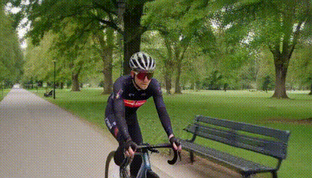

# Ascend-H3

[English](README.md)

将 MiniMax H3 的 Full、VSA、Veda、VDN、Spark-H3 昇腾注意力实现
整合到同一个仓库，复用 vLLM-Omni 的模型加载、INT8 量化和 attention
head 多卡并行。

**当前仍在进行整合验收。** 自定义 CANN 算子已从源码编译通过；
尚未将所有“方法 × 精度 × 视频规格 × 并行规模”标记为通过。
下文历史性能数据与这个仓库的整合验收分开记录。

## 四组视频规格

| case | 空间分辨率 | 原生输出帧数 | 视频 token 网格 |
| --- | --- | --- | --- |
| `672-124` | 672×384 | 124 | 37×12×21 |
| `672-345` | 672×384 | 345 | 102×12×21 |
| `1344-124` | 1344×768 | 124 | 37×24×42 |
| `1344-345` | 1344×768 | 345 | 102×24×42 |

输出 24 FPS。请求直接指定帧数，关闭插帧。长视频保留原生 345 帧，
不裁剪成 341 帧。BF16 和 INT8 均使用这四组规格。

## 安装与编译

使用 Linux、Python 3.12 及匹配的 Ascend Torch/CANN 环境。
vLLM、vLLM-Ascend、vLLM-Omni 的固定版本和验收状态见
[环境说明](docs/environment.md)，避免混装不同版本。

```bash
git clone https://github.com/Huage001/Ascend-H3.git
cd Ascend-H3
source /path/to/Ascend/cann/set_env.sh
bash scripts/install_stack.sh /path/to/private/framework-sources
export H3_ASCEND_CACHE=/path/to/writable/ascend-h3-cache
h3-ascend build --method all --soc Ascend910B3
```

编译不需要占用 NPU，生成的动态库放在仓库外的缓存目录中。
只编译一种方法时，将 `all` 换成 `vsa`、`veda` 或 `spark`。
Full 和 VDN 不需要这里的自定义 CANN 扩展。当前使用源码可编辑安装，
安装后保留 checkout 中的 `configs/` 和 `csrc/`。

## 模型和算法

| 方法 | 所需权重 | 注意力机制 |
| --- | --- | --- |
| `full` | 原生 H3，可选匹配的 Turbo LoRA | 全注意力 |
| `vsa` | H3 + 带训练后 compression gate 的 Sol-H3 VSA LoRA | 逻辑 tile64，选中的两个 KV64 在片上配对成 KV128 计算 |
| `veda` | H3 + 对应 Turbo LoRA + Veda predictor | 每层、每个 head 动态选块，默认名义稀疏度 90% |
| `vdn` | H3 + 官方 VDN stage-DMD 权重目录 | local softmax + 保留 128 维状态的 DeltaNet 分支 |
| `spark` | H3 + 对应 Turbo LoRA | 内容相关层次分块，原 token 与 proxy 联合 softmax，精确分支默认名义稀疏度 90% |

模型权重需按原项目许可自行下载，不包含在本仓库中。不同蒸馏模型
具有不同的权重和采样规则；不能认为任意权重直接换算子就能保证画质。
VSA 必须加载训练后的非零 gate；VDN 必须加载其学习得到的分支权重。
官方权重下载及准备命令见[模型准备](docs/weights.md)。

此前导出的**已应用缩放、含 AdaLN 的 363-target Diffusers Turbo8**
适配器，需要先创建明确的格式和采样清单：

```bash
h3-ascend prepare-lora --source /models/turbo8-diffusers.safetensors \
  --output /models/H3-Turbo-LoRA --steps 8 --video-shift 12 --audio-shift 3
```

该命令记录权重哈希与采样规则，并链接原权重，不会重复应用 alpha 缩放。
带清单的适配器在普通权重加载期间融合，再进行 head 切分和 INT8 量化，
使用普通 layerwise offload。需要保留链接指向的权重文件。
原始 LightX2V 文件走原生 loader，不能标记成“已应用缩放”的格式。

## 启动服务

只使用没有其他计算进程的卡。单卡 Full：

```bash
export ASCEND_RT_VISIBLE_DEVICES=0
h3-ascend serve --method full --model /models/MiniMax-H3 \
  --precision bf16 --devices 1
```

其他注意力：

```bash
h3-ascend serve --method vsa --model /models/MiniMax-H3 \
  --lora /models/Sol-H3-VSA-LoRA --precision bf16 --devices 1
h3-ascend serve --method veda --model /models/MiniMax-H3 \
  --lora /models/H3-Turbo-LoRA --predictor /models/veda/predictor.safetensors \
  --precision bf16 --devices 1
h3-ascend serve --method vdn --model /models/MiniMax-H3 \
  --lora /models/VDN/stage-dmd-step-250 --precision bf16 --devices 1
h3-ascend serve --method spark --model /models/MiniMax-H3 \
  --lora /models/H3-Turbo-LoRA --precision bf16 --devices 1
```

同一组卡一次只启动一个服务。加入 `--dry-run` 可查看生成的原生
vLLM-Omni 命令，不会加载权重。

**INT8：** 任意方法将 `--precision bf16` 改为 `--precision int8`。
底层使用 vLLM-Omni 原生量化配方：

```json
{"transformer":{"method":"int8"}}
```

INT8 投影输出的 BF16 Q/K/V 进入注意力。注意力累加、Veda predictor、
VDN 状态计算保留各自规定的精度，不能将其描述成“注意力全程 INT8”。
原生配方会将不支持的层保留为 BF16。例如单卡 H3 的一项投影输出宽度
为 96,768，超过量化矩阵乘的 65,535 限制；TP 可以缩小每卡宽度，
让相应层进入可量化范围。

**四卡：** 默认采用 vLLM 原生 TP 的 attention head 切分：

```bash
export ASCEND_RT_VISIBLE_DEVICES=0,1,2,3
h3-ascend serve --method spark --model /models/MiniMax-H3 \
  --lora /models/H3-Turbo-LoRA --precision int8 --devices 4 --parallel tp
```

`--devices` 支持 1、2、4、7、8，均可整除 56 个 head。
Veda 在分片后仍使用原 checkpoint 的全局 head 编号。
七卡 DiT TP 时，文本编码器使用一张卡，因为其 64 个 query head、
8 个 KV head 不能按七份切分。
VSA、VDN 和带明确清单的旧版适配器使用普通 layerwise offload，保留加载时
权重融合。其余方法使用 distributed layerwise offload，常驻 16 层 DiT。
text encoder 同样参与 layerwise offload。
非 VDN 方法另提供 `--parallel ulysses` 选项；默认策略是用户要求的 TP。

## 生成四组视频

先启动服务，再创建 UTF-8 prompt 文件并发送请求：

```bash
printf '%s\n' 'A cyclist rides through a green park, cinematic tracking shot.' > prompt.txt
for CASE in 672-124 672-345 1344-124 1344-345; do
  h3-ascend generate --case "$CASE" --prompt-file prompt.txt \
    --steps 8 --seed 42 --output "outputs/${CASE}.mp4"
done
```

匹配的四步 Sol-H3 学生模型使用 `--steps 4`；VDN stage-DMD 使用八步。
非蒸馏 Full 使用对应原生模型的采样规则。`--guidance-scale` 为可选参数，
省略时保留模型原生 CFG 策略。本项目不额外增加 Refine 阶段。
客户端同时保存 MP4 和包含请求、阶段耗时的 JSON 记录。

## 性能数据

加速比统一为 **同卡 Full 耗时 / 对应方法耗时**。以下为此前独立实验的
单卡历史数据，使用 BF16 激活、代表层 0/24/49，精确稀疏分支的名义
稀疏度为 90%。这些数字不是整段视频的端到端加速比，也不是新仓库
整合后的验收成绩。

VSA 保留训练后的压缩分支；Spark 保留官方的 anchor 条件化 proxy 和
未选中块的 log-mass 修正。名义稀疏度指精确 token 分支，不代表全部计算量。

下面统计 QKV 已就绪后的注意力 dispatch，包含路由、重排、注意力和
输出还原，不含 QKV / output 投影：

| 视频规格 | 昇腾 VSA | 昇腾 Veda | 昇腾 Spark | PRO6000 VSA | PRO6000 Veda | PRO6000 Spark |
| --- | ---: | ---: | ---: | ---: | ---: | ---: |
| 672×384，124 帧 | 1.14× | 1.34× | — | 0.97× | 0.84× | 0.88× |
| 672×384，345 帧 | 1.59× | 2.52× | — | 1.55× | 2.47× | 1.89× |
| 1344×768，124 帧 | 2.22× | 4.10× | 2.49× | 2.23× | 4.45× | 2.65× |
| 1344×768，345 帧 | 3.40× | 6.64× | 4.12× | 3.51× | 6.73× | 4.36× |

VDN 包含学习得到的投影和额外分支，单独使用**含 QKV / output 投影的
完整 attention module**计时：

| 视频规格 | 昇腾 VDN128 相对 Full | PRO6000 官方 VDN128 相对 Full |
| --- | ---: | ---: |
| 672×384，124 帧 | 0.49× | 0.61× |
| 672×384，345 帧 | 0.85× | 1.04× |
| 1344×768，124 帧 | 1.01× | 1.14× |
| 1344×768，345 帧 | 2.35× | 2.63× |

VDN 不能与上一张表直接排名。低于 1 表示比 Full 慢。
昇腾和 NVIDIA 分别使用各自优化后的 Full 基线，相近的加速比不代表
绝对时延相同。精确数值和来源摘要见
[历史记录](benchmarks/historical-results.json)。空缺值以及新仓库的
INT8、多卡性能仍需实测，不以历史结果代替。

PRO6000 VSA 一列为 2026-10-30 新测：官方 Triton tile64、代表层 24、
十轮交替计时，非零 compression gate 在计时前准备。
[原始记录](benchmarks/pro6000-vsa64-20261030.json)随仓库保存。
较早的昇腾 VSA/Veda 使用共享合成 QKV；NVIDIA Veda/Spark 及昇腾 Spark
使用真实权重投影的合成激活。因此跨设备加速比作为参考，不能表述成
逐元素相同 QKV 的严格比较。

## 效果与验证范围

以下示例由本仓库完整链路生成：Full、原生 INT8、TP2、672×384、124 帧、
Turbo8、seed 42，包含音频。两个 rank 均完成八次 DiT 前向，每步执行全部
50 个 block，输出有限，QKV 权重确认为 INT8。


[带音频 MP4](examples/videos/full-int8-tp2-672124.mp4) ·
[样例参数与校验值](examples/videos/full-int8-tp2-672124.json)。
这只是单个定性样例；记录审计会引入同步，不能用作性能测量，也不能据此宣称感知等价。

VSA INT8、原生 TP4、672×384、124 帧、四步 VSA 学生模型也已完整成片：
四个 rank 均完成四次 DiT 前向，每一步检查到全部 50 个非零 gate。



[带音频 MP4](examples/videos/vsa-int8-tp4-672124.mp4) ·
[样例参数](examples/videos/vsa-int8-tp4-672124.json)。
逐帧检查发现该 VSA INT8 样例在约 3.4 秒处有短暂亮度回落，
原因待 BF16 对照排查。生成检查通过不代表没有闪烁或画质等价。
该样例用于定性验收，不是 Full 与 VSA 的画质等价评估。
VSA INT8 TP4 的四种视频规格现已全部通过完整生成和解码，
[审计矩阵](benchmarks/vsa-int8-tp4-matrix.json)记录各规格帧数与视频校验值。

Veda INT8 TP4、672×384、124 帧、Turbo8、seed 42、名义稀疏度 90%：


[带音频 MP4](examples/videos/veda-int8-tp4-672124.mp4) ·
[样例参数](examples/videos/veda-int8-tp4-672124.json)。
Veda INT8 TP4 的四种规格均已完整生成和解码，见
[审计矩阵](benchmarks/veda-int8-tp4-matrix.json)。

此前严格 Spark 实验已生成 1344×768 的 124/345 帧视频，与优化前昇腾
参考实现的每个解码后 uint8 像素一致。这证明的是昇腾实现之间的一致性，
不等于与 CUDA 或 Full 输出一致，框架整合后还需要重新验收。
此前 VDN 短视频样例可正常成片。其求逆是数值近似；自动策略下的 BF16
时间卷积还会比上游 FP32 tap 累加更早发生一次特征舍入。FP32 时间卷积
选项见[架构说明](docs/architecture.md)。不宣称逐位 Cholesky 等价，
也不据单个样例宣称普遍画质等价。

首版目标是 batch=1、无参考视频的 T2VA。更多信息见
[架构设计](docs/architecture.md)、[验证状态](docs/validation.md)
及[第三方许可](THIRD_PARTY_NOTICES.md)。
