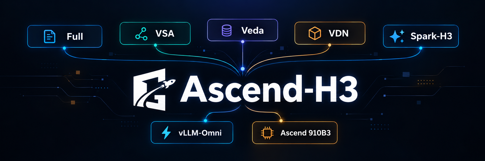
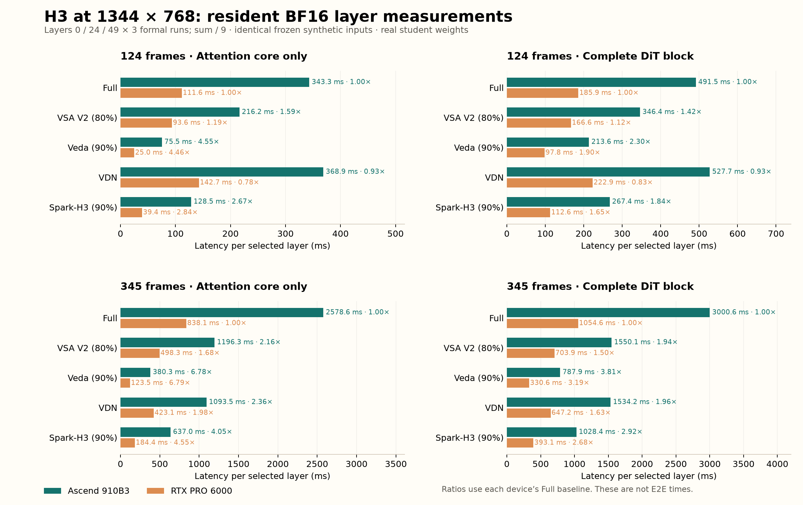

<p align="center">
  
</p>

<h1 align="center">Ascend-H3</h1>

<div align="center">

[](../LICENSE)
[](../docs/environment.md)
[](../docs/environment.md)
[](../docs/validation.md)
[](../docs/environment.md)

</div>

<p align="center"><a href="#install">Installation</a> | <a href="#models">Models</a> | <a href="#serve">Serve</a> | <a href="#performance">Performance</a></p>

<div align="center">

[English](../README.md) | [简体中文](../README.zh-CN.md) | [繁體中文](../i18n/README.zh-TW.md) | [한국어](../i18n/README.ko.md) | [Español](../i18n/README.es.md) | [日本語](../i18n/README.ja.md) | [हिन्दी](../i18n/README.hi.md) | [मराठी](../i18n/README.mr.md) | **Русский** | [Português](../i18n/README.pt.md) | [తెలుగు](../i18n/README.te.md) | [Français](../i18n/README.fr.md) | [Deutsch](../i18n/README.de.md) | [Italiano](../i18n/README.it.md) | [Tiếng Việt](../i18n/README.vi.md) | [العربية](../i18n/README.ar.md) | [اردو](../i18n/README.ur.md) | [বাংলা](../i18n/README.bn.md) | [فارسی](../i18n/README.fa.md) | [Română](../i18n/README.ro.md) | [Türkçe](../i18n/README.tr.md)

</div>



> Этот полный README представляет собой перевод английского README с помощью искусственного интеллекта в коммите be5c42e03f9a. Оно может устареть; самую свежую информацию смотрите в английской версии. [English](../README.md)

> **Translation notice:** Machine-translated and not technically reviewed; errors may occur. Use the English README as the authoritative reference for commands, requirements, and benchmark results.

Вывод MiniMax H3 для Ascend с полным вниманием, VSA, Veda, VDN и Spark-H3 в одном репозитории. Интеграция повторно использует загрузку модели vLLM-Omni, преобразование квантования INT8 и собственные тензорные параллельные головки внимания.

**Подтвержденный объем:** 40/40 ячеек E2E INT8 с разрешением 1344×768, 124/345 кадров и 1/2/4/8 NPU (37 свежих измерений и 3 явно отмеченных ячейки исторического слоя с разгрузкой). Резидентное сравнение BF16 на Ascend 910B3 и PRO 6000 содержит 20 измерений ядра внимания и 20 измерений полного блока. Операторы внимания сохраняют свои проверенные версии.

## Рабочие нагрузки 768p по умолчанию

| Дело | Ширина × высота | Собственные выходные кадры | Скрытая видеосетка |
| --- | --- | --- | --- |
| `1344-124` | 1344×768 | 124 | 37×24×42 |
| `1344-345` | 1344×768 | 345 | 102×24×42 |

Выходной FPS равен 24. В запросах используется явный подсчет кадров с отключенной интерполяцией кадров. Длинный случай — это согласованная собственная рабочая нагрузка в 345 кадров; он не обрезан до 341 кадра. BF16 и INT8 используют эти две рабочие нагрузки с разрешением 1344×768. Если опустить `--case`, будет выбран `1344-124`.

<a id="install"></a>

## Установка

Используйте Linux, Python 3.12 и совместимую среду Ascend Torch/CANN. Установите закрепленный стек vLLM, vLLM-Ascend и vLLM-Omni, описанный в[примечаниях к среде](../docs/environment.md). Не объединяйте несвязанные выпуски платформы. Затем установите этот репозиторий из исходного кода:

```bash
git clone https://github.com/Huage001/Ascend-H3.git
cd Ascend-H3
source /path/to/Ascend/cann/set_env.sh
bash scripts/install_stack.sh /path/to/private/framework-sources
export H3_ASCEND_CACHE=/path/to/writable/ascend-h3-cache
h3-ascend build --method all --soc Ascend910B3
```

Сборки не содержат весов моделей и выполняются без использования NPU. Нативные библиотеки компилируются локально и хранятся вне кассы. Для одного серверного модуля замените `all` на `vsa`, `veda` или `spark`; Для версий Full и VDN эти специальные расширения CANN не требуются. Держите редактируемую кассу доступной.

<a id="models"></a>

## Контрольные точки и выбор алгоритма

| Метод | Необходимые ресурсы модели | Вычисление |
| --- | --- | --- |
| `full` | база H3; LightX2V 8 шагов по умолчанию или сообщество LoRA | Плотное внимание |
| `vsa` | Полный официальный студент FastH3 V2, включая все 50 обученных компрессионных ворот. | 8 перенаправлений, разреженность видео 80%; логический КВ64, выбранные блоки КВ спарены в КВ128 на кристалле |
| `veda` | База H3 + LightX2V 8-шаговый + официальный обученный предиктор Veda | Динамические поголовные блочные маршруты Veda, номинальная разреженность 90 %. |
| `vdn` | База H3 + официальный каталог контрольных точек VDN stage-DMD | Локальный softmax плюс 128-мерная изученная ветвь DeltaNet |
| `spark` | База H3 + LightX2V 8-ступенчатая | Spark-H3 иерархические разделы и объединенные точные/прокси softmax, номинальная разреженность точных ветвей 90 % |

Загрузите модели по оригинальным лицензиям. Веса не перераспределяются. Разные ученики имеют разное расписание и выученные правила; переключение внимания на произвольные веса не гарантирует качество сопоставления. VSA требует ненулевых обученных вентилей. VDN требует изученных весов ветвей. Команды загрузки и подготовки находятся в[ресурсах модели](../docs/weights.md).

Full, Veda и Spark по умолчанию включают закрепленный **LightX2V восьмиступенчатый LoRA**. Используйте `--no-few-step-lora` для запуска исходной многошаговой модели. Подготовленное сообщество `--lora /models/style` объединяется с LightX2V перед завершением загрузки; отключить учащегося по умолчанию при явном выборе другого учащегося сообщества. Veda всегда нуждается в официальном обученном предсказателе. VSA принимает только полную официальную **полную контрольную точку FastH3 V2**: восемь вперед, разреженность видео 80%, сдвиг видео/аудио 10/3, tile64, руководство 1. Он загружает освобожденные веса напрямую и не принимает `--lora`. VDN принимает только свою полную официальную контрольную точку этапа DMD. Ни один из них не принимает дополнительный флаг сообщества LoRA или флаг отключения учащихся.

```bash
# Optional: provide the exact pinned LightX2V source locally instead of downloading.
h3-ascend serve --method full --model /models/MiniMax-H3 --devices 1 \
  --few-step-source /models/minimax_h3_fl2v_turbo_8step_v1.0_768p_bf16.safetensors
# Optional original 50-step model; the reporting baseline is Full eight-step.
h3-ascend serve --method full --model /models/MiniMax-H3 --devices 1 --no-few-step-lora
# General already-scaled Diffusers community LoRA, with no forced step schedule.
h3-ascend prepare-lora --source /models/style.safetensors --output /models/style
```

Официальный источник PEFT один раз нормализуется с использованием заявленного альфа/ранга; подготовленные файлы проверяются по хешу. Все выбранные адаптеры объединяются перед нарезкой TP и квантованием INT8. Умножения матриц LoRA во время запроса не выполняются. См.[подготовку модели](../docs/weights.md) для получения информации о исходных форматах и ​​фиксированных расписаниях.

<a id="serve"></a>

## Запустить сервер

Используйте только устройства, на которых нет других вычислительных процессов. Для одной карты:

```bash
export ASCEND_RT_VISIBLE_DEVICES=0
h3-ascend serve --method full --model /models/MiniMax-H3 \
  --precision int8 --devices 1 --offload text
```

Другие бэкэнды используют тот же серверный API:

```bash
h3-ascend serve --method vsa --model /models/FastH3-V2 \
  --precision int8 --devices 1 --offload text
h3-ascend serve --method veda --model /models/MiniMax-H3 \
  --predictor /models/veda/predictor.safetensors \
  --precision int8 --devices 1 --offload text
h3-ascend serve --method vdn --model /models/MiniMax-H3 \
  --lora /models/VDN/stage-dmd-step-250 --precision int8 --devices 1 --offload text
h3-ascend serve --method spark --model /models/MiniMax-H3 \
  --precision int8 --devices 1 --offload text
```

Запускайте по одному серверу на выбранных устройствах. Добавьте `--dry-run`, чтобы проверить сгенерированную собственную команду vLLM-Omni без загрузки модели.

Примеры с одной картой осуществляют потоковую передачу текстового кодировщика, сохраняя при этом резидентный INT8 DiT. Собственный рецепт квантует DiT; кодировщик текста остается BF16, поэтому его объем памяти все равно необходимо включить в политику запуска. Для **BF16** используйте `--precision bf16`; при необходимости явно выберите `--offload layer --no-precompute-adaln`. INT8 использует собственный рецепт:

```json
{"transformer":{"method":"int8"}}
```

Проекции INT8 привлекают внимание к BF16 Q/K/V. Аккумуляторы внимания, прогнозы Veda и состояние VDN сохраняют заданную точность. Это вывод модели INT8, а не утверждение, что каждая операция внимания является INT8. Собственный рецепт сохраняет неподдерживаемые слои в BF16. H3 для одной карты имеет ширину проекции 96 768, что превышает предел квантованного вывода Matmul NPU, равный 65 535; TP может уменьшить ширину каждого ранга до диапазона.

Для **вывода по четырем картам** используйте собственное тензорное параллельное разделение головок:

```bash
export ASCEND_RT_VISIBLE_DEVICES=0,1,2,3
h3-ascend serve --method spark --model /models/MiniMax-H3 \
  --precision int8 --devices 4 --parallel tp

# Eight cards: seven DiT attention heads per rank.
export ASCEND_RT_VISIBLE_DEVICES=0,1,2,3,4,5,6,7
h3-ascend serve --method full --model /models/MiniMax-H3 \
  --precision int8 --devices 8 --parallel tp
```

`--devices` поддерживает 1, 2, 4, 7 и 8, которые делят 56 головок. Veda сохраняет глобальные идентификаторы головок предиктора после сегментирования. Семикарточный DiT TP использует один ранг кодировщика текста, поскольку его головки с 64 запросами и 8 кВ не могут делиться на семь. Запускает по умолчанию `--offload none` (резидентные веса). Если памяти недостаточно, `--offload text` передает в потоковом режиме только кодировщик текста, сохраняя при этом DiT на устройстве; `--offload module` заменяет полные компоненты (экспериментальная квалификация); `--offload layer` передает оба компонента в потоковом режиме, сохраняя один активный и один предварительно выбранный блок. В приведенной ниже ссылке на согласованную разгрузку явно используется `--offload layer` (`omni-layer-prefetch1-vae-resident-v1`) на обеих аппаратных платформах. В новых сквозных измерениях используется только **INT8**, начиная с резидентного выполнения и отмечая все необходимые резервные возможности разгрузки. При сравнении изолированного внимания и блоков DiT используется BF16 на обоих устройствах: слои 0/24/49, по три прогона в каждом, суммирование девяти таймингов и деление на девять. Дополнительный `--parallel ulysses` предоставляется для путей, отличных от VDN; TP остается значением по умолчанию. Встроенное тайловое декодирование VAE теперь по умолчанию применяется ко всем выбранным картам (`--vae-parallel-size 0`); используйте `--vae-parallel-size 1` для одного ранга декодера. Конвейер INT8 Full/124-frame прошел с одним, двумя, четырьмя и восемью рангами VAE. Другие комбинации метода/подсчета кадров остаются в матрице E2E.

Резидентные запуски NPU подготавливают результаты AdaLN до готовности сервера. При подготовке разрешается загруженная модель и объединяются фактические положения сигмы LoRA, счетчик обновлений DiT и сдвиги видео/аудио; он не жестко запрограммирован на восемь шагов. Используйте `serve --steps N`, чтобы указать запуск учителя/ученика, и используйте тот же счетчик в `generate --steps N`. Противоречивое уточненное расписание контрольных точек отклоняется. Емкость кэша растет вместе с требуемыми планами. Исходная математика проекции сохраняется; Основные веса AdaLN остаются на ЦП, а подготовленные результаты — на NPU. TP4/TP8 также запоминает встроенные временные коды на основе точных входных данных временных шагов, чтобы избежать низкобитовых изменений при уменьшении FP32, приводящих к недействительности нисходящих кэшей. Веса, числовые настройки и совпадение совпадений для всех рангов по-прежнему защищают повторное использование. Перезапустите новую конфигурацию, чтобы предварительно рассчитать другое расписание; неподготовленный ввод использует исходные вычисления и может передавать веса. `--no-precompute-adaln` отключает подготовку; Потоковая передача модуля/слоя DiT по умолчанию отключена.

Для Spark/VSA/VDN с одной картой и 345 кадрами используйте `--offload layer --no-precompute-adaln` с оригинальными проверенными операторами. В таблице E2E эти ячейки разгрузки собственного слоя помечены знаком †L; ‡R идентифицирует совпадающие измерения, повторно использованные из предыдущего запуска. Все остальные ячейки сохраняют свою индивидуально записанную политику проживания.

Средство запуска устанавливает крайний срок запроса встроенного рабочего процесса на 7200 секунд, поэтому длинное видео не прерывается из-за 600-секундного значения по умолчанию для восходящего потока. Установите `VLLM_OMNI_DLO_DP_WAVE_TIMEOUT` перед запуском, чтобы обойти это ограничение; он меняет поведение ожидания, а не расчет модели или измеренную продолжительность запроса.

## Создайте два случая 768p.

Создайте файл подсказки UTF-8, запустите сервер, затем используйте соответствующее количество шагов:

```bash
printf '%s\n' 'A cyclist rides through a green park, cinematic tracking shot.' > prompt.txt
for CASE in 1344-124 1344-345; do
  h3-ascend generate --case "$CASE" --prompt-file prompt.txt \
    --method full --seed 7 --output "outputs/${CASE}.mp4"
done
```

Передайте серверный `--method` клиенту: все пять методов (Full/VSA/Veda/VDN/Spark) по умолчанию используют восемь фактических перенаправлений. Для дополнительной исходной многошаговой модели используйте `generate --method full --no-few-step-lora` (50 шагов), соответствующий серверу. Явный `--steps` остается доступным для отдельно подготовленного учащегося сообщества. `--guidance-scale` является необязательным; бездействие сохраняет местную политику. Стадия уточнения не добавляется. Клиент сохраняет MP4 и квитанцию ​​о времени JSON.

<!-- BEGIN BF16 LAYER RESULTS -->

## Сравнение слоев BF16: постоянно на обоих устройствах

Разрешение 1344х768, только 124/345 кадров. Реальные веса студентов и байт-идентичные замороженные синтетические скрытые состояния; это не активации слоев, полученные из видеозапроса. Каждый из слоев 0, 24 и 49 получает по две разминки без учета времени и три формальных забега: **суммируйте девять таймингов и делите на девять**. Веса остаются постоянными на обоих устройствах. Активации/основные веса: BF16; необходимые предикторы FP32, накопления и состояние VDN сохраняются. В ускорениях используется то же самое оборудование и та же форма BF16 Full baseline. Более высокое относительное ускорение выделено жирным шрифтом; Также отображается абсолютная задержка.

### Внимание только ядро

Начинается с подготовленного Q/K/V и заканчивается выводом внимания. Исключает проекцию QKV, норму Q/K, RoPE, проекцию вывода, AdaLN и FFN. Включает необходимые разреженные элементы, прогнозирование, выбор, перестановку и восстановление; VDN включает в себя как полные ядра Softmax, так и линейные ядра. Каждый метод использует эту границу; тайминги всего модуля не заменяются. Ядро синхронизации завершило 10/10 согласованных пар оборудования; ожидающие ячейки не используют повторно предыдущие измерения модуля.

| Рамки | Метод | Задержка Ascend | ПРО 6000 задержка | Ascend ускорение | ПРО 6000 ускорение |
| ---: | --- | ---: | ---: | ---: | ---: |
| 124 | Full | 343.31 ms | 111.64 ms | 1.00× | 1.00× |
| 124 | VSA V2 · 80% | 216.24 ms | 93.56 ms | **1.59×** | 1.19× |
| 124 | Veda · 90% | 75.50 ms | 25.01 ms | **4.55×** | 4.46× |
| 124 | VDN · official | 368.89 ms | 142.74 ms | **0.93×** | 0.78× |
| 124 | Spark-H3 · 90% | 128.54 ms | 39.35 ms | 2.67× | **2.84×** |
| 345 | Full | 2578.60 ms | 838.10 ms | 1.00× | 1.00× |
| 345 | VSA V2 · 80% | 1196.30 ms | 498.34 ms | **2.16×** | 1.68× |
| 345 | Veda · 90% | 380.26 ms | 123.45 ms | 6.78× | **6.79×** |
| 345 | VDN · official | 1093.46 ms | 423.12 ms | **2.36×** | 1.98× |
| 345 | Spark-H3 · 90% | 636.98 ms | 184.38 ms | 4.05× | **4.55×** |

### Полный блок DiT

Выполняется от входа блока до выхода блока, включая проекции, нормализацию, RoPE, ядро внимания, AdaLN, FFN и остаточные операции. Измеряется независимо от ядра; их разница не является измерением FFN и не экстраполируется во время E2E.

| Рамки | Метод | Задержка Ascend | ПРО 6000 задержка | Ascend ускорение | ПРО 6000 ускорение |
| ---: | --- | ---: | ---: | ---: | ---: |
| 124 | Full | 491.51 ms | 185.93 ms | 1.00× | 1.00× |
| 124 | VSA V2 · 80% | 346.40 ms | 166.56 ms | **1.42×** | 1.12× |
| 124 | Veda · 90% | 213.56 ms | 97.76 ms | **2.30×** | 1.90× |
| 124 | VDN · official | 527.75 ms | 222.89 ms | **0.93×** | 0.83× |
| 124 | Spark-H3 · 90% | 267.42 ms | 112.65 ms | **1.84×** | 1.65× |
| 345 | Full | 3000.60 ms | 1054.58 ms | 1.00× | 1.00× |
| 345 | VSA V2 · 80% | 1550.07 ms | 703.92 ms | **1.94×** | 1.50× |
| 345 | Veda · 90% | 787.91 ms | 330.60 ms | **3.81×** | 3.19× |
| 345 | VDN · official | 1534.19 ms | 647.19 ms | **1.96×** | 1.63× |
| 345 | Spark-H3 · 90% | 1028.43 ms | 393.06 ms | **2.92×** | 2.68× |

[Все записи из девяти прогонов и входные проверки личности](../benchmarks/bf16-three-layer.json).

<!-- END BF16 LAYER RESULTS -->

<!-- BEGIN INT8 E2E MATRIX -->

<a id="performance"></a>

## INT8 E2E: Ascend 1/2/4/8 карт

1344×768, восемь актуальных обновлений DiT, включая кодирование текста, декодирование видео/аудио и запись MP4. Загрузка, предварительное слияние LoRA, подготовка AdaLN и прогревы исключены. Предпочитаю резидента DiT; Резидентные строки проверяют отсутствие промахов AdaLN и перенос веса на каждом ранге вокруг формального запроса. После записи OOM маркированные ячейки из 345 кадров с одной картой используют собственный уровень разгрузки и сопоставления повторного использования, полностью проверяя предыдущие измерения в соответствии с запросом; эти ячейки явно помечены, а не представлены как свежие измерения.

| Рамки | Метод | 1 карта | 2 карты | 4 карты | 8 карт |
| ---: | --- | ---: | ---: | ---: | ---: |
| 124 | Full | 197.66 s †T | 116.03 s | 64.78 s | 35.87 s |
| 124 | VSA V2 · 80% | 146.81 s †T | 93.57 s | 53.47 s | 30.40 s |
| 124 | Veda · 90% | 97.40 s †T | 69.66 s | 43.38 s | 25.33 s |
| 124 | VDN · official | 216.91 s †T | 136.02 s | 79.26 s | 44.36 s |
| 124 | Spark-H3 · 90% | 117.11 s †T | 79.41 s | 48.87 s | 29.05 s |
| 345 | Full | 1211.17 s †T | 649.72 s †T | 328.63 s | 178.81 s |
| 345 | VSA V2 · 80% | 617.55 s †L ‡R | 363.99 s †T | 193.33 s | 104.71 s |
| 345 | Veda · 90% | 337.95 s †T | 225.31 s †T | 130.11 s | 75.93 s |
| 345 | VDN · official | 620.67 s †L ‡R | 388.58 s †T | 209.84 s | 117.27 s |
| 345 | Spark-H3 · 90% | 419.44 s †L ‡R | 267.61 s †T | 150.50 s | 87.02 s |

Покрыто **40/40**: 37 свежих и 3 повторно использованных предыдущих измерения. †T: только разгрузка слоя кодировщика текста; †L: собственный уровень DiT/текстового кодировщика, разгрузка с одноуровневой предварительной выборкой и резидентный VAE; ‡R: соответствие исходным размерам из 2026-10-31. Неотмеченные ячейки не имеют разгрузки во время выполнения. Предварительное вычисление AdaLN выполняется только для резидентных строк; Строки Layer-Offload не предъявляют никаких требований о резидентности DiT или нулевой передаче AdaLN. VAE ранжирует количество карт; Головки DiT разделены 56/28/14/7. Родное покрытие INT8 сохраняется.[INT8 записи E2E](../benchmarks/ascend-int8-e2e.json)

<!-- END INT8 E2E MATRIX -->

Ранее сопоставленное сравнение слоев и разгрузки сохраняется в[исторической ссылке на одну карту](../docs/archive/matched-offload-single-card.md). Повторно используемые ячейки в текущей таблице связаны с неизмененными исходными записями.

## Качественные результаты и валидация

Только Ascend 910B3: **1344×768, 345 собственных кадров, 24 кадра в секунду (14,375 секунды, примерно 14,4 секунды)**, со звуком.

Все пять методов используют восемь форвардов. Слева: BF16. Справа: родной W8A8 INT8. Во всех примерах используется одна карта, одно и то же приглашение, общее начальное число **7** и соответствующая разгрузка.

> Велосипедист едет по тихой зеленой парковой дорожке, плавный кинематографический кадр, естественный дневной свет.

<!-- BEGIN QUALITATIVE GALLERY -->
<table>
<tr><th width="50%">BF16</th><th width="50%">INT8 (W8A8)</th></tr>
<tr>
<td>

**Полная + LightX2V8 · 8 шагов**

https://github.com/user-attachments/assets/1751d9fe-3ff9-48d1-a0dd-9ed62d431d17

</td>
<td>

**Полная + LightX2V8 · 8 шагов**

https://github.com/user-attachments/assets/0514e9a0-76dd-4946-b4b8-b39ca38d7c69

</td>
</tr>
<tr>
<td>

**VSA · FastH3 V2 · 80% · 8 шагов**

https://github.com/user-attachments/assets/4a03fd28-4c88-4b46-b3aa-7dcb4ec4b1c1

</td>
<td>

**VSA · FastH3 V2 · 80% · 8 шагов**

https://github.com/user-attachments/assets/bae64455-0bbc-4708-b33e-1e1a4269e4cf

</td>
</tr>
<tr>
<td>

**Veda + LightX2V8 · 90% · 8 шагов**

https://github.com/user-attachments/assets/2c345f2b-4188-48d1-b0fc-6a44dd59800b

</td>
<td>

**Veda + LightX2V8 · 90% · 8 шагов**

https://github.com/user-attachments/assets/bc8e2eb5-b51b-4a53-bf9b-05c432dfe62a

</td>
</tr>
<tr>
<td>

**VDN · официально · 8 шагов**

https://github.com/user-attachments/assets/5e4d2ced-da14-4e50-b7ac-6ff1d298d478

</td>
<td>

**VDN · официально · 8 шагов**

https://github.com/user-attachments/assets/7069c2e4-844c-497b-a824-7a26a515dce2

</td>
</tr>
<tr>
<td>

**Spark-H3 + LightX2V8 · 8 шагов**

https://github.com/user-attachments/assets/66032d79-cf29-499e-ad0e-3f1bcaa753a9

</td>
<td>

**Spark-H3 + LightX2V8 · 8 шагов**

https://github.com/user-attachments/assets/c4a787a9-c1e9-46df-97f1-2887c7e49135

</td>
</tr>
</table>
<!-- END QUALITATIVE GALLERY -->

VSA V2 использует разреженность видео 80 %; Veda использует 90%. Текст и аудио сохраняют свои исходные правила.[Параметры, SHA256 и происхождение для всех десяти видео](../examples/videos/qualitative-1344-345.json). Полное декодирование проверяет 345 кадров и звук; Визуально просматривалось 16 однородных кадров каждого клипа. Отдельные учащиеся не считаются эквивалентными по пикселям или по восприятию. VSA сохраняет изменения кадров; гарантия отсутствия мерцания не предоставляется.

Первоначальная интеграция нацелена на первую партию T2VA без справочных видеороликов. См.[архитектуру](../docs/architecture.md),[статус проверки](../docs/validation.md) и[уведомления третьих лиц](../THIRD_PARTY_NOTICES.md).
